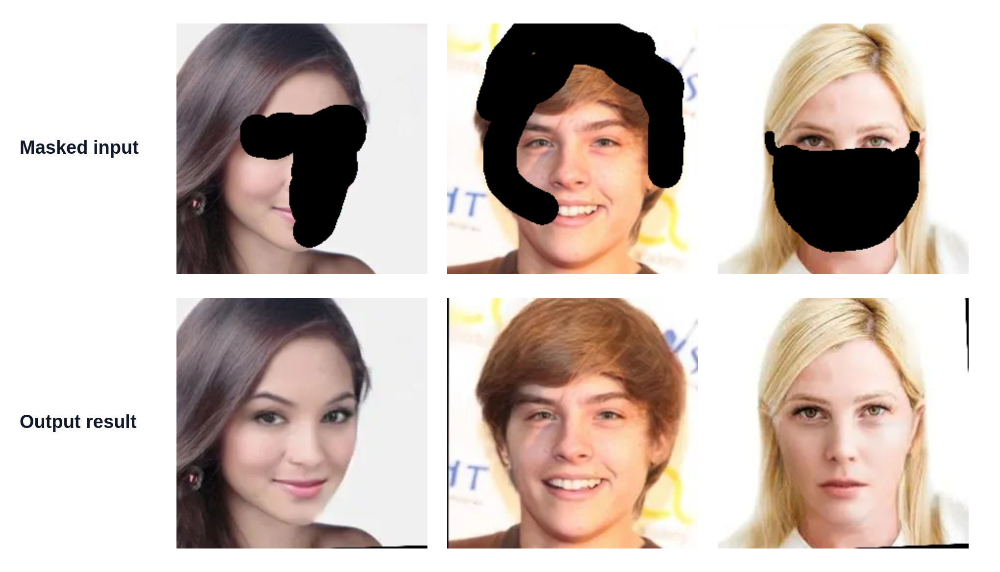

<div align="center">

# 🎨 DTLS-Face-Inpaint

### A Novel Inpainting Framework with Latent Space Domain Transfer

Face image inpainting through domain transfer in latent space.

**Hon Man Hammond Lee · Wan-Chi Siu · Ivan Wang-Hei Ho · H. Anthony Chan**


[Live Demo](https://inpaint.hamlee.top) · [Checkpoint — GitHub Release](https://github.com/Hammond65/DTLS-Face-Inpaint/releases/latest/download/celeba-256.pt) · [OneDrive backup](https://connectpolyu-my.sharepoint.com/:u:/g/personal/24144327r_connect_polyu_hk/IQD7__xQlZzPT6Cd1ECBKlleAWZ-lNAFJrRZbD9tLk189GY?e=mfpvw7)

</div>

<p align="center">
	
</p>
<p align="center"><em>Masked inputs (left) and inpainted results (right).</em></p>

## Overview

DTLS-Face-Inpaint is a face image inpainting framework that uses **Domain Transfer in Latent Space (DTLS)** to restore masked regions. This repository includes an interactive Gradio demo and configuration-driven scripts for inference and training.

## Quick Start

### 1. Create an environment

```bash
conda create -n dtls-face-inpaint python=3.10 -y
conda activate dtls-face-inpaint
```

### 2. Install dependencies

```bash
pip install torch torchvision --index-url https://download.pytorch.org/whl/cu126
pip install -r requirements.txt
```

> The PyTorch command installs CUDA 12.6 wheels. For CPU or a different CUDA version, install the PyTorch build that matches your system.

## Pretrained Checkpoint

Download the checkpoint from [GitHub Releases](https://github.com/Hammond65/DTLS-Face-Inpaint/releases/latest/download/celeba-256.pt). If the release download is unavailable, use the [OneDrive backup](https://connectpolyu-my.sharepoint.com/:u:/g/personal/24144327r_connect_polyu_hk/IQD7__xQlZzPT6Cd1ECBKlleAWZ-lNAFJrRZbD9tLk189GY?e=mfpvw7). Place the downloaded file at `weights/celeba-256.pt`.

## Interactive Demo

```bash
python app.py
```

Open the local URL printed by Gradio. The hosted demo is also available at [inpaint.hamlee.top](https://inpaint.hamlee.top).

## Inference

Before running inference, update the `trainer` paths in `config/trainer/eval_256_celeba.yaml`:

- `data_path`: dataset directory.
- `input_image`: evaluation directory containing paired images and masks. Image filenames should begin with `image` and mask filenames with `mask` (for example, `image_001.png` and `mask_001.png`).
- `results_folder`: directory where results will be saved.
- `load_path`: checkpoint path, if using a checkpoint outside `weights/celeba-256.pt`.

Then run:

```bash
python main.py -c ./config/trainer/eval_256_celeba.yaml
```

## Training

Update `trainer.data_path`, `trainer.input_image`, and `trainer.results_folder` in `config/trainer/train_256.yaml`. The `input_image` directory should contain paired evaluation images and masks, using the filename prefixes described above. Then start training:

```bash
python main.py -c ./config/trainer/train_256.yaml
```

## Configurations

| Task | Configuration |
| --- | --- |
| Interactive demo | `config/trainer/app.yaml` |
| CelebA evaluation | `config/trainer/eval_256_celeba.yaml` |
| FFHQ evaluation | `config/trainer/eval_256_ffhq.yaml` |
| Training | `config/trainer/train_256.yaml` |

Copyright

Copyright preserve by The Hong Kong Polytechnic University and Saint Francis University. Users can use this package for further development. However, it is not for commerical use.